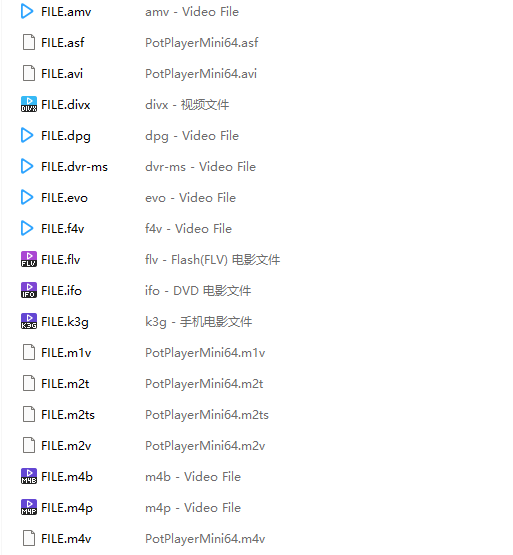

<div align="center">

<h1>ExtensionTestFile</h1>

[](#)
[](#)
[](LICENSE)

> 一键生成各类常见媒体格式的“空文件”，你可以直观地通过**文件图标**的变化，判断这些扩展名是否已正确关联到你偏好软件

</div>

## 📸 部分展示


## 📂 涉及的格式

### 📺 视频(Video)
```text
avi wmv wmp wm asf mpg mpeg mpe m1v m2v mpv2 mp2v ts tp tpr trp vob ifo ogm ogv mp4 m4v m4p m4b 3gp 3gpp 3g2 3gp2 mkv rm ram rmvb rpm flv mov qt nsv dpg m2ts m2t mts dvr-ms k3g skm evo nsr amv divx webm wtv f4v mxf
```

### 🎵 音频 (Audio)
```text
wav wma mpa mp2 m1a m2a mp3 ogg m4a aac mka ra flac ape mpc mod ac3 eac3 dts dtshd wv tak cda dsf tta aiff aif opus amr
```

### 📜 播放列表 (Playlist)
```text
asx m3u m3u8 pls wvx wax wmx cue mpls mpl dpl xspf mpd
```

## 🚀 使用

- 双击 `CreateExtensionTestFile.exe` 即可，文件生成在**程序所在目录**下的 `Test` 文件夹。

- 命令行用法：
>
> ```bat
> CreateExtensionTestFile.exe [-o <目录>] [-h]
> ```
>
> | 参数 | 说明 |
> | --- | --- |
> | `-o`, `--out <目录>` | 指定输出目录（默认：程序所在目录下的 `Test`） |
> | `-h`, `--help` | 显示帮助信息 |

## ⬇️ 下载使用

[](https://github.com/NeetheCheeBao/ExtensionTestFile/releases)

## 🛠️ 本地编译

1. 克隆仓库到本地

```bash
git clone https://github.com/NeetheCheeBao/ExtensionTestFile.git
```

或者

```bash
gh repo clone NeetheCheeBao/ExtensionTestFile
```

2. 一键编译

```bat
.\build.bat
```

- 产物位置：`dist\ExtensionTestFile.exe`

## 🗂️ 项目结构

```text
ExtensionTestFile
|   .gitignore
|   build.bat           一键编译脚本
|   LICENSE
|   README.md
|
+---assets
|       app.manifest    DPI 感知与系统兼容性声明
|       app.rc          资源脚本
|       icon.ico        程序图标
|
+---screenshot
|       demo.png        截图
|
\---src
        generator.cpp   扩展名清单与文件生成
        generator.hpp   生成器接口与结果结构
        main.cpp        程序入口、参数解析、输出与弹窗
```

## ⚖️ 许可证

本项目采用 MIT 许可证 - 详情请参阅 [LICENSE](LICENSE) 文件。
